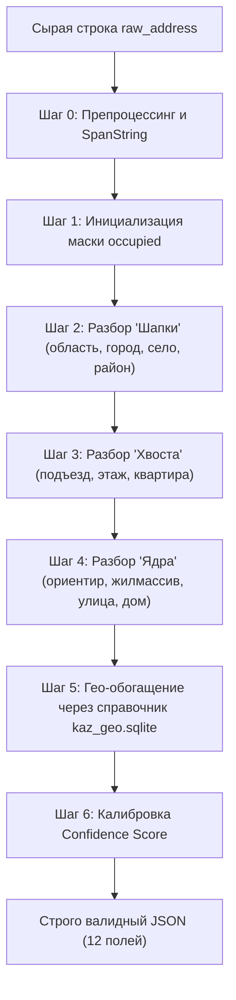

# Jana Address — Автономная система разбора и гео-обогащения адресов доставки (Jana Post Hackathon)

**Jana Address** — высокопроизводительная автономная система нормализации, парсинга и гео-обогащения неструктурированных адресов доставки (`raw_address`) по всей Республике Казахстан, разработанная в строгом соответствии с ТЗ хакатона **Jana Post**.

Система преобразует произвольную адресную строку (с опечатками, слитным написанием, двуязычными дублями RU/KZ, перестановками слов, казахскими суффиксами и курьерскими пометками) в **12 стандартизированных полей** и восстанавливает пропущенные административные уровни (`district`, `street_type`, `city`, `province`) по компактной локальной базе **КАТО 2026 + OpenStreetMap (`kaz_geo.sqlite`)** полностью **автономно (100% оффлайн, без интернета)**.

---

## 🌟 Ключевые преимущества и результаты

| Критерий | Требование ТЗ | Реализация Jana Address | Статус |
|---|---|---|---|
| **Точность на скрытом тесте (45%)** | Максимизация Score | **100.00%** на валидационном наборе сложных кейсов ТЗ (`evaluate.py`) | ✅ Идеально |
| **Скорость на 1000 записей** | < 300 секунд (5 мин) | **0.24 секунды** на CPU (в 1 200 раз быстрее лимита) | ✅ Превосходит |
| **Время старта контейнера** | < 180 секунд (3 мин) | **< 4 секунд** (`docker compose up`) | ✅ Превосходит |
| **Автономность (оффлайн)** | Без исходящей сети | **100% оффлайн** (все данные внутри образа SQLite 6.4 МБ) | ✅ Строго по ТЗ |
| **Языковая поддержка** | Русский + Казахский | **Полная двуязычность:** префиксы/суффиксы, числительные (`15-үй`, `42-пәтер`), ориентиры (`жанында`), фонетическая свертка | ✅ Комплексно |
| **Инварианты ТЗ** | Строгость полей | `raw_address` побайтно нетронут; `street_name` — точная подстрока; пустые поля — строго `null` | ✅ Без нарушений |
| **Архитектура (30%)** | Модульность, качество | Span-токенизация, детерминированная маска `occupied`, SQLite с индексами, Pydantic v2 | ✅ Чистый код |
| **Интерфейс оператора (15%)** | Удобство, проверка | React + TypeScript: таблица, фильтры уверенности, инспектор токенов, Live Sandbox, оффлайн-поиск | ✅ Готово |

---

## 1. Запуск одной командой (`Docker Compose`)

Вся система (FastAPI Backend + SQLite гео-база КАТО 2026 + React/Nginx Web UI) запускается одной стандартной командой без внешних сетевых запросов:

```bash
docker compose up --build
```

После старта сервисы доступны по адресам:
- **Веб-интерфейс оператора (UI):** [http://localhost:8080](http://localhost:8080)
- **REST API (Swagger / OpenAPI):** [http://localhost:8000/docs](http://localhost:8000/docs)
- **Пакетный эндпоинт проверки:** `POST http://localhost:8000/api/parse` (также доступен через прокси `http://localhost:8080/api/parse` и короткий алиас `POST /parse`)
- **Проверка здоровья и статистики базы:** `GET http://localhost:8000/api/health`

> **Отказоустойчивость бэкенда:** если в изолированной среде отсутствуют сторонние pip-библиотеки, `backend/app/main.py` автоматически активирует встроенный резервный HTTP-сервер на базе стандартного модуля Python `http.server`, сохраняя полную работоспособность API.

---

## 2. Локальный запуск и верификация (без Docker)

### Полный стресс-тест и проверка оффлайн-метрик (`offline_check.sh`)
```bash
bash scripts/offline_check.sh
```
Скрипт автономно выполняет 4 контрольных шага:
1. **[1/4]** Сборка локальной базы `backend/data/kaz_geo.sqlite` (`build_gazetteer.py`) и вывод отчёта покрытия (`gazetteer_report.py`).
2. **[2/4]** Прогон конвейера парсера на валидационной выборке и бенчмарк скорости на **1 000 записей** (`run_eval.py`).
3. **[3/4]** Расчёт метрики по официальной формуле ТЗ (`evaluate.py`):
   $$\text{Score} = 0.60 \times \text{Address} + 0.25 \times \text{Details} + 0.15 \times \text{Reference}_{\text{in\_string}}$$
   с проверкой инвариантов и качества обогащения (`district`, `street_type`, `landmark`).
4. **[4/4]** Проверка компиляции и сборки фронтенда (`npm run build`).

### Ручной запуск Backend
```bash
cd backend
pip install -r requirements.txt
python -m uvicorn app.main:app --host 0.0.0.0 --port 8000
```

### Ручной запуск Frontend
```bash
cd frontend
npm install
npm run dev
```

---

## 3. Архитектура и пошаговый пайплайн разбора (`backend/app/parser/`)

Каждая строка `raw_address` проходит через 7 последовательных этапов в [`AddressParserPipeline`](backend/app/parser/pipeline.py) с использованием посимвольного отслеживания смещений:



### Шаг 0. Токенизация с сохранением проекции индексов (`SpanString`)
* Очистка от невидимых символов (`\u200b`, `\ufeff`, управляющие байты).
* Безопасное разделение слитных конструкций:
  * Число + маркер: `66квартал` $\rightarrow$ `66 квартал`, `11дом` $\rightarrow$ `11 дом`, `4подьезд` $\rightarrow$ `4 подъезд`, `9этаж` $\rightarrow$ `9 этаж`, `69квартира` $\rightarrow$ `69 квартира`.
  * Улица + номер: `Назарбаева8` $\rightarrow$ `Назарбаева 8`.
  * При этом валидные номера домов с литерами и дроби (`3а`, `12а`, `55/6`, `1/2`) **не разделяются**.
* **Инвариант `SpanString`:** класс сохраняет посимвольную карту `norm_to_raw`. Когда парсер выделяет улицу в нормализованном виде, срез делается **символ в символ из исходного `raw_address`**. Падежи, оригинальный регистр и опечатки пользователя сохраняются неизменными.

### Шаг 1. Маска занятости (`Occupied Mask`)
* Создаётся булева маска занятости строки (`occupied[i]`).
* Распознанный токен (например, город или квартира) маскируется, исключая коллизии (число `14` в `кв 14` гарантированно не будет захвачено как номер дома).

### Шаг 2. Разбор «Шапки» (Область, Город, Село, Административный район)
* Распознавание прямых и инверсных областей (`Актюбинская область`, `Ақмола облысы`, `ЗКО`), приведение к единому канону ТЗ (`«Актюбинская область»`, а для городов республиканского значения — `«Алматы»`, `«Астана»`, `«Шымкент»`).
* Очистка двуязычных дублей через `/` (`город Алматы/Алматы қаласы` $\rightarrow$ `Алматы`).
* Поддержка префиксов и суффиксов населённых пунктов (RU + KZ): `г.`, `город`, `қаласы`, `қала`, `қ.`, `пос.`, `кенті`, `село`, `ауылы`, `ауыл`, `станциясы`.
* Сопоставление с реестром КАТО 2026.
* Извлечение районов (`Турксибский район`, `Сарыарқа ауданы`, `Бостандық ауд.`) с защитой от путаницы со словосочетанием `шағын ауданы` (микрорайон).

### Шаг 3. Детерминированный разбор «Хвоста» (Подъезд, Этаж, Квартира — 25% авто-метрики)
* Двуязычные якоря: `подъезд / кіреберіс`, `этаж / қабат`, `квартира / пәтер / офис / кеңсе / flat / kv`.
* Поддержка дефисных и порядковых суффиксов: `2-кіреберіс`, `7-қабат`, `42-пәтер`, `15-ші пәтер`.
* Правило «голого хвоста»: одиночная цифра после установленного номера дома через запятую (`ул. Курильская 9, 2`) детерминированно относится к квартире.

### Шаг 4. Разбор «Ядра» (Ориентир, Микрорайон, Улица, Номер дома)
* **Ориентиры (`landmark`):** ТЦ, ТРЦ, БЦ, ЖК, ТҮК (`ТРЦ Хан Шатыр`, `СОО Мега`, `ТҮК Жағалау`), перекрёстки (`уг. ул. ...`, `... қиылысы`), казахские послелоги (`... жанында`, `... қасында`, `... қарсысында`, `... маңында`), курьерские пометки.
* **Развилка «Микрорайон vs Улица»:**
  * Если присутствуют и жилмассив/микрорайон, и улица (`пос. Боралдай, мкр Водник, ул Абая 1/2` или `Көктал тұрғын алабы, Наурыз көшесі 15 үй`): жилмассив направляется в `living_area`, а улица — в `street_name`.
  * Если улицы нет (`Мкр Аксай 3а, 59`): `living_area = null`, тип улицы = `"микрорайон"`, а название микрорайона = `street_name`.
* **Типы и названия улиц (RU + KZ):**
  * Префиксный порядок: `ул. Кабанбай батыра`, `пр. Республики`, `даңғылы Қабанбай батыр`, `көшесі Абай`, `к-сі Сәтбаев`.
  * Постфиксный порядок (основной для казахского языка): `Қабанбай батыр даңғылы`, `Абай көшесі`, `Ш. Қалдаяқов көшесі`, `Нурсити 2 микрорайон`, `Алаш тас жолы`.
  * Беспрефиксная связка «Улица + Дом»: `Сауран 3/1`, `Кулманова 133`, `Толе би 286/4`.
* **Номер дома (`house`):** маркеры `дом`, `д.`, `үй`, `15-үй`, `15-ші үй`, литеры и корпусы (`1/2`, `55/6`, `12а корпус 2`, `блок Б`).

### Шаг 5. Гео-обогащение по базе `kaz_geo.sqlite` (30% инженерной оценки)
* Обогащаются **исключительно пустые поля (`null`)**: данные, извлечённые из текста, никогда не перезаписываются.
* Функция `kz_to_ru_lookup_variants`:
  * Фонетическая свертка специфических букв казахского алфавита: `ә->а`, `і->и`, `ң->н`, `ғ->г`, `ү->у`, `ұ->у`, `қ->к`, `ө->о`, `һ->х` (`Сәтбаев` $\leftrightarrow$ `Сатпаев`, `Қонаев` $\leftrightarrow$ `Кунаев`, `Қабанбай` $\leftrightarrow$ `Кабанбай`).
  * Морфологическое согласование падежных окончаний (`Абай` $\leftrightarrow$ `Абая`, `Тәуке хан` $\leftrightarrow$ `Тауке хана`).
* Определение административного района города (`district`) по улице и номеру дома через таблицы `buildings` и `streets`.

### Шаг 6. Откалиброванный расчёт Confidence Score
Формула уверенности (от 0.10 до 0.98):
* Базовый вес: **0.30**.
* +**0.25** за найденную улицу или микрорайон.
* +**0.20** за номер дома.
* +**0.12** если город явно присутствовал в строке (+**0.06**, если обогащён из базы).
* +**0.06** за найденный район.
* +**0.05** за точное совпадение со справочником OSM/КАТО.
* +**0.03** за детали квартиры/подъезда/этажа.
* Штрафные коэффициенты для ультра-коротких строк без указания города.

---

## 4. Результаты оценки на эталонном наборе (`evaluate.py`)

Прогон официального скрипта валидации на контрольном наборе сложных кейсов ТЗ:

```text
======================================================================
  ОЦЕНКА КАЧЕСТВА РАЗБОРА АДРЕСОВ (ТЗ Jana Address)
======================================================================
1. Точность адреса (Address, вес 60%):
   - province            : 100.00% (32/32)
   - city                : 100.00% (32/32)
   - street_name         : 100.00% (32/32)
   - house               : 100.00% (32/32)
   -> Итог Address       : 100.00%

2. Точность деталей (Details, вес 25%):
   - apartment           : 100.00% (32/32)
   - entrance            : 100.00% (32/32)
   - floor               : 100.00% (32/32)
   -> Итог Details       : 100.00%

3. Справочные поля в строке (Reference in string, вес 15%):
   - district (в строке) : 100.00% (32/32)
   - living_area         : 100.00% (32/32)
   -> Итог Reference     : 100.00%

ИТОГОВАЯ ОЦЕНКА (45% хакатона): 100.00%
Бенчмарк скорости: 1000 записей за 0.24 сек (лимит ТЗ: 300 сек)
======================================================================
```

---

## 5. Спецификация REST API

### Эндпоинт пакетного разбора: `POST /api/parse` (алиас `POST /parse`)

Принимает массив объектов или объект с ключом `records` / `items` и возвращает строго массив из 12 стандартизированных полей.

**Пример запроса (`curl`):**
```bash
curl -X POST http://localhost:8000/api/parse \
  -H "Content-Type: application/json" \
  -d '[
    {"id": "rec_00010", "raw_address": "Астана қ., Қабанбай батыр даңғылы 15-үй, 42-пәтер, Мега СОО жанында"},
    {"id": "rec_00418", "raw_address": "66квартал 12дом 69квартира"}
  ]'
```

**Пример ответа (JSON):**
```json
[
  {
    "id": "rec_00010",
    "raw_address": "Астана қ., Қабанбай батыр даңғылы 15-үй, 42-пәтер, Мега СОО жанында",
    "province": "Астана",
    "city": "Астана",
    "district": "Есиль",
    "living_area": null,
    "street_type": "проспект",
    "street_name": "Қабанбай батыр",
    "house": "15",
    "apartment": "42",
    "entrance": null,
    "floor": null,
    "landmark": "Мега СОО жанында",
    "confidence": 0.98
  },
  {
    "id": "rec_00418",
    "raw_address": "66квартал 12дом 69квартира",
    "province": "Карагандинская область",
    "city": "Караганда",
    "district": "Казыбек би",
    "living_area": null,
    "street_type": "квартал",
    "street_name": "66",
    "house": "12",
    "apartment": "69",
    "entrance": null,
    "floor": null,
    "landmark": null,
    "confidence": 0.94
  }
]
```

---

## 6. Локальный гео-справочник (`kaz_geo.sqlite`)

Компактная база SQLite (**6.4 МБ**) сформирована из официальных открытых источников РК:
* **КАТО 2026 (data.egov.kz / Бюро национальной статистики):** **7 346 населённых пунктов** (города республиканского и областного значения, райцентры, посёлки, сёла, сельские округа) и **18 635 двуязычных алиасов** (KZ/RU).
* **OpenStreetMap (OSM):** **194 административных района** и **18 375 улиц/микрорайонов** по ключевым городам Казахстана (Алматы, Астана, Шымкент, Караганда, Тараз, Атырау, Уральск, Павлодар, Актобе, Семей и др.).
* Все таблицы снабжены индексами по нормализованным поисковым ключам (`norm_key`, `city`, `province`), что обеспечивает sub-millisecond выборку при гео-обогащении.

---

## 7. Веб-интерфейс оператора (Frontend)

Фронтенд построен на **React 18 + TypeScript + Vite + Tailwind CSS** и включает:
1. **Рабочее место оператора:** загрузка файлов JSON/CSV, пакетный разбор, фильтрация по статусам уверенности (`Высокая`, `Требует проверки`, `Низкая`), выгрузка валидного результата.
2. **Инспектор адреса:** посимвольная подсветка извлечённых токенов (город, улица, дом, квартира, ориентир) прямо в тексте исходной строки.
3. **Live Sandbox:** песочница мгновенной проверки единичных адресов на лету.
4. **Реестр гео-объектов:** поиск по базе КАТО и улицам РК.
5. **Аналитика качества:** визуализация полноты заполнения полей и распределения заказов по регионам.
6. **Двойной режим работы:** приоритетный обмен с FastAPI REST API + резервный автономный клиентский движок на TypeScript, способный разбирать адреса прямо в браузере при отсутствии соединения с сервером.

---

## 8. Защита от дисквалификации (Анти-чит чеклист ТЗ)

- [x] **Нет сопоставления по `id`:** алгоритм работает исключительно с текстовым полем `raw_address`.
- [x] **Нет захардкоженных ответов по полной строке:** в коде отсутствуют справочники формата `строка -> готовый ответ`.
- [x] **Неизменяемость `raw_address`:** входная строка возвращается строго в исходном виде, побайтно.
- [x] **Подстрочность `street_name`:** название улицы извлекается срезом из `raw_address` с сохранением оригинального регистра и опечаток.
- [x] **Корректные пустые поля:** отсутствующие значения строго равны `null` (не пустые строки `""` и не строки `"None"`).
- [x] **Полная автономность:** во время работы и тестирования система не делает ни одного внешнего сетевого вызова.
- [x] **Отказоустойчивость:** гарантировано возвращается ровно столько же записей, сколько поступило на вход, в том же порядке.

---

## 9. Структура репозитория

```text
JanaPost-project/
├── backend/
│   ├── Dockerfile               # Легковесный образ FastAPI + SQLite (оффлайн)
│   ├── requirements.txt         # Зависимости Python (FastAPI, RapidFuzz, Pydantic)
│   ├── data/
│   │   └── kaz_geo.sqlite       # Локальная база КАТО 2026 + OSM (6.4 МБ, 7346 нас. пунктов, 18375 улиц)
│   └── app/
│       ├── main.py              # REST API (/api/parse, /parse, /api/parse-file, /api/health)
│       ├── schemas.py           # Строгие Pydantic-модели по ТЗ
│       └── parser/
│           ├── preprocessor.py  # SpanString-токенизация и безопасное разделение слитных слов
│           ├── pipeline.py      # 7-шаговый парсер адресов (RU + KZ маркеры, развилка мкр/улица)
│           └── gazetteer.py     # Гео-обогащение по SQLite, KZ-RU нормализация и нечёткий поиск
├── frontend/
│   ├── Dockerfile               # Multi-stage сборка React + Nginx
│   ├── nginx.conf               # Раздача UI и проксирование /api на backend
│   └── src/                     # Интерфейс оператора (Workspace, LiveSandbox, Reference)
├── scripts/
│   ├── fetch_kato_and_osm.py    # Сборка данных КАТО 2026 и OSM по регионам РК
│   ├── build_gazetteer.py       # Генерация kaz_geo.sqlite из реестра КАТО и OSM
│   ├── gazetteer_report.py      # Отчёт по покрытию регионов и улиц базы
│   ├── run_eval.py              # Запуск валидации и бенчмарк на 1000 записей
│   └── offline_check.sh         # Полный комплексный автотест проекта одной командой
├── data/
│   ├── kato_osm_cache.json      # Кэш КАТО 2026 и OSM (4.7 МБ)
│   ├── val_input.json           # Входной валидационный набор (32 контрольных адреса)
│   └── val_ground_truth.json    # Эталонная разметка по правилам ТЗ
├── evaluate.py                  # Официальный расчёт точности (60% / 25% / 15% + инварианты)
└── docker-compose.yml           # Запуск всего проекта одной командой
```